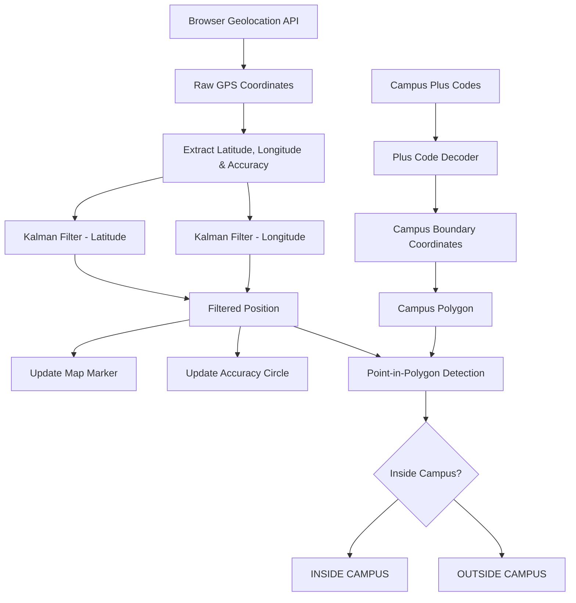

#  InCampus — Real-Time Campus GPS & Geofencing

> A browser-based campus location tracking system that visualizes real-time GPS positioning, smooths noisy location data using Kalman filtering, and determines whether a user is inside or outside a predefined campus boundary.

<p align="center">
  <strong>Real-Time GPS • Kalman Filtering • Geofencing • OpenStreetMap • Plus Codes</strong>
</p>

---

##  Overview

**InCampus** is a lightweight web-based location monitoring application designed to visualize a user's real-time geographic position relative to a predefined campus boundary.

GPS readings from smartphones and other devices are inherently noisy. Small variations in satellite signals, environmental interference, and device positioning can cause location markers to jump around even when the user is stationary.

InCampus addresses this problem using a **1D Kalman Filter independently applied to latitude and longitude**, producing a smoother estimated position. The filtered coordinates are then evaluated against a custom campus boundary using a point-in-polygon algorithm.

The application displays the user's position on an interactive map, visualizes GPS accuracy, and dynamically determines whether the user is currently inside or outside the campus perimeter.

The project combines geospatial visualization, signal filtering, coordinate decoding, and spatial geometry in a simple client-side application without requiring a backend server.

---

##  Features

###  Real-Time GPS Tracking
- Uses the browser's native Geolocation API.
- Continuously tracks the device's geographic position.
- Updates the user marker dynamically as new GPS readings arrive.
- Uses high-accuracy positioning mode.
- Displays live latitude and longitude coordinates.

###  GPS Noise Reduction with Kalman Filtering

Raw GPS measurements can fluctuate due to measurement noise.

InCampus implements a lightweight **1D Kalman Filter** for both latitude and longitude to stabilize the displayed position.

- Separate filter instances for latitude and longitude.
- Measurement noise parameter (`r`).
- Process noise parameter (`q`).
- Estimate covariance (`p`).
- Adaptive Kalman gain.
- Continuous state estimation from incoming GPS measurements.

Instead of directly plotting every raw GPS reading, the application uses the filtered estimate to update the location marker and perform campus-boundary detection.

###  Campus Geofencing

InCampus uses a predefined geographic polygon to represent the campus perimeter.

- Campus boundary defined using Full Plus Codes.
- Boundary points decoded into geographic coordinates.
- Polygon generated dynamically using Leaflet.
- Continuous location validation against the polygon.
- Real-time `INSIDE CAMPUS` / `OUTSIDE CAMPUS` status.

The boundary is constructed from multiple ordered geographic points rather than relying on a simple circular radius.

###  Interactive Map

Powered by **Leaflet.js** and OpenStreetMap.

- Interactive map navigation.
- Zoom and pan.
- Real-time user location marker.
- Campus perimeter polygon.
- Visual boundary reference points.
- GPS accuracy circle.
- Automatic map fitting to the campus boundary.

###  GPS Accuracy Visualization

The application displays the estimated accuracy reported by the device's GPS provider.

- Accuracy displayed in meters.
- Dynamic accuracy circle around the estimated location.
- Circle radius updated with each location reading.
- Helps distinguish a location estimate from a perfectly precise coordinate.

###  Full Plus Code Decoder

InCampus includes a built-in decoder for full Open Location Codes (Plus Codes).

This allows the campus perimeter to be defined using Plus Codes and converted into latitude/longitude coordinates directly in JavaScript.

The decoder supports:

- Validation of full Plus Code format.
- Character decoding using the Open Location Code alphabet.
- Latitude and longitude pair decoding.
- Grid refinement for additional code precision.
- Conversion into geographic cell-center coordinates.

No external Plus Code decoding library is required.

###  Live Status Dashboard

The map interface includes a compact information panel displaying:

| Information | Description |
|---|---|
| GPS Accuracy | Current location accuracy in meters |
| Coordinates | Filtered latitude and longitude |
| Boundary Count | Number of points defining the campus boundary |
| Filter Status | Indicates whether Kalman filtering is active |
| Location Status | Displays whether the user is inside or outside the campus |

###  Error Handling

The application handles common location and initialization errors:

- Geolocation permission denied.
- GPS position unavailable.
- GPS request timeout.
- Unsupported browser geolocation.
- Leaflet library loading failure.
- Campus boundary decoding errors.

---

##  How It Works

InCampus follows a continuous geospatial processing pipeline.



### Step 1 — Obtain GPS Coordinates

The browser requests the device's location using:

```javascript
navigator.geolocation.watchPosition()
```

The application receives location measurements containing:

- Latitude
- Longitude
- Reported GPS accuracy
- Other location metadata supplied by the browser

High-accuracy mode is requested through the Geolocation API configuration.

### Step 2 — Filter GPS Measurements

The raw latitude and longitude are independently passed through two Kalman filter instances.

```javascript
const kLat = new Kalman1D();
const kLng = new Kalman1D();
```

The filter estimates the current coordinate by balancing the previous estimate against the new GPS measurement.

The Kalman gain determines how strongly the incoming measurement influences the existing estimate.

### Step 3 — Update the Map

The filtered coordinates are used to update:

- The user's location marker.
- The GPS accuracy circle.
- The displayed coordinates.

This provides a smoother map experience compared with plotting the raw GPS coordinates directly.

### Step 4 — Decode Campus Boundary

Campus boundary points are stored as Full Plus Codes.

The built-in decoder converts each Plus Code into a geographic coordinate pair:

```text
Plus Code → Latitude → Longitude
```

The decoded coordinates are then used to construct the campus polygon.

### Step 5 — Perform Geofencing

The filtered location is checked against the campus polygon using the **Ray Casting Point-in-Polygon algorithm**.

The algorithm determines whether a point lies inside a polygon by checking how many times a ray extending from the point intersects the polygon's edges.

- Odd number of intersections → Inside
- Even number of intersections → Outside

The application performs this check continuously as new GPS measurements arrive.

### Step 6 — Display the Result

The status indicator is updated dynamically.

| Condition | Display |
|---|---|
| User inside campus polygon | 🟢 INSIDE CAMPUS |
| User outside campus polygon | 🔴 OUTSIDE CAMPUS |
| GPS permission denied | 🔴 GPS PERMISSION DENIED |
| GPS unavailable | 🔴 GPS POSITION UNAVAILABLE |
| GPS timeout | 🔴 GPS REQUEST TIMEOUT |

---

##  Algorithms Used

### 1. Kalman Filter

The application implements a simplified scalar Kalman filter for coordinate estimation.

#### Prediction

The estimate covariance is increased to account for process uncertainty:

\[
P_{k}^{-}=P_{k-1}+Q
\]

#### Kalman Gain

\[
K_k=\frac{P_k^{-}}{P_k^{-}+R}
\]

#### State Update

\[
X_k=X_{k-1}+K_k(Z_k-X_{k-1})
\]

#### Covariance Update

\[
P_k=P_k^{-}(1-K_k)
\]

Where:

| Symbol | Meaning |
|---|---|
| \(X_k\) | Current estimated coordinate |
| \(Z_k\) | Incoming GPS measurement |
| \(P_k\) | Estimate covariance |
| \(Q\) | Process noise |
| \(R\) | Measurement noise |
| \(K_k\) | Kalman gain |

The filter initializes with the first available GPS measurement and subsequently updates the estimate using new observations.

> The current implementation filters latitude and longitude independently. It is a lightweight smoothing approach rather than a full motion-aware GPS model.

### 2. Ray Casting — Point-in-Polygon

The geofencing algorithm checks whether a coordinate lies inside the campus polygon.

For each polygon edge, the algorithm evaluates whether the edge intersects a horizontal ray originating from the test point.

The inside/outside state toggles for each valid intersection.

```text
Point + Polygon
      │
      ▼
Check polygon edges
      │
      ▼
Count ray intersections
      │
      ├── Odd → Inside
      │
      └── Even → Outside
```

**Time complexity:** \(O(n)\)

Where \(n\) is the number of vertices in the campus polygon.

For a campus boundary containing a relatively small number of vertices, this is computationally inexpensive and suitable for repeated real-time checks.

### 3. Open Location Code (Plus Code) Decoding

The decoder processes Full Plus Codes and reconstructs geographic positions using the Open Location Code character alphabet.

It handles:

- Initial latitude/longitude encoding pairs.
- Pair-based geographic resolution.
- Additional grid refinement.
- Geographic cell-center calculation.

This allows the campus perimeter to be maintained in a compact human-readable geographic format.

---

## 🛠️ Tech Stack

| Technology | Purpose |
|---|---|
| HTML5 | Application structure |
| CSS3 | Interface styling and layout |
| JavaScript (ES6+) | GPS logic, filtering, geometry and application functionality |
| Leaflet.js | Interactive mapping and geospatial visualization |
| OpenStreetMap | Map tile data |
| Browser Geolocation API | Real-time device positioning |
| Open Location Code | Plus Code-based campus boundary representation |

---

##  Project Structure

```text
InCampus/
│
├── index.html      # Main application structure
├── style.css      # Interface styling
├── script.js      # GPS, mapping, filtering and geofencing logic
└── README.md      # Project documentation
```


---


### Installation

**1. Clone the repository**

```bash
git clone https://github.com/SaswataA04/InCampus.git
```

**2. Navigate to the project directory**

```bash
cd InCampus
```

**3. Run the application**

The simplest way is to open `index.html` through a local development server.

Using VS Code Live Server:

1. Open the project folder in VS Code.
2. Install the Live Server extension if necessary.
3. Right-click `index.html`.
4. Select **Open with Live Server**.

Alternatively, run a local server using Python:

```bash
python -m http.server 8000
```

Then open:

```text
http://localhost:8000
```

**4. Grant location permission**

When the browser asks for location access, select **Allow**.

The application should begin receiving location updates and display your position on the map.

---

##  Usage

1. Launch InCampus in a supported browser.
2. Allow location access when prompted.
3. Wait for the initial GPS measurement.
4. Observe the location marker on the map.
5. View the reported GPS accuracy.
6. Observe the filtered coordinates as new readings arrive.
7. Check the campus status indicator to determine whether the current estimated position lies inside or outside the configured boundary.

---

##  Campus Boundary Configuration

The campus perimeter is defined in the JavaScript source using an array of Full Plus Codes.

```javascript
const campusBoundaryPlusCodes = [
    "7MJCPFR4+7X7",
    "7MJCPFR4+8V9",
    "7MJCPFR4+9RM",
    // Additional ordered boundary points...
];
```

Each code represents a geographic location used to construct the perimeter.

### To customize the campus boundary

1. Obtain the Plus Codes for the campus perimeter.
2. Arrange the codes in the correct order around the boundary.
3. Replace the existing values in `campusBoundaryPlusCodes`.
4. Maintain a consistent perimeter order.
5. Reload the application.
6. Inspect the polygon visually on the map.

The order of the points matters because the polygon connects each vertex to the next.

Incorrectly ordered points can create an intersecting or malformed polygon and cause incorrect boundary detection.

---

##  GPS Accuracy vs. Filtered Coordinates

InCampus displays both the reported GPS accuracy and the filtered position.

These values represent different concepts:

| Metric | Meaning |
|---|---|
| Raw GPS Position | Location measurement received from the device |
| Filtered Position | Smoothed coordinate estimated by the Kalman filter |
| GPS Accuracy | Approximate uncertainty reported by the location provider |
| Geofence Status | Whether the filtered position falls inside the campus polygon |

Kalman filtering can reduce visible fluctuations caused by noisy measurements, but it cannot guarantee that the estimated location is geographically correct.

The accuracy circle is based on the location provider's reported accuracy and should be treated as an approximate uncertainty visualization, not a guaranteed boundary.

---

##  Privacy & Permissions

InCampus uses browser-based location services to obtain the device's position.

- Location access requires explicit browser permission.
- GPS data is used by the application for map visualization and campus-boundary checking.
- The current implementation does not require a backend server for its core functionality.
- Location access can be revoked through browser settings.
- The application should be used only with appropriate consent.

The project is intended for transparent, permission-based location awareness and campus geofencing.

---

##  Limitations

The accuracy and behavior of the application depend on the device, browser, GPS environment, and campus boundary configuration.

- GPS performance may degrade indoors, near tall buildings, or under poor signal conditions.
- Kalman filtering smooths measurements but may introduce lag when the user moves quickly.
- Latitude and longitude are filtered independently without a velocity or movement model.
- Geofencing accuracy depends on the quality and ordering of the polygon vertices.
- Boundary decisions may fluctuate when the estimated position is very close to the perimeter.
- GPS accuracy reported by the browser may not reflect the true positioning error.
- The application requires internet access for map tiles and external libraries loaded from CDN sources.
- The browser may throttle location updates depending on device and operating system behavior.

InCampus is currently a prototype for location visualization and geofencing experimentation, not a certified navigation, security, attendance, or emergency-location system.

---

##  Future Improvements

Potential directions for expanding InCampus:

### Geofencing Improvements
- [ ] Add configurable entry and exit buffers.
- [ ] Implement hysteresis to reduce boundary status flickering.
- [ ] Add multiple campus zones and sub-boundaries.
- [ ] Support user-defined boundary editing directly on the map.
- [ ] Add proximity alerts when approaching campus boundaries.

### GPS & Filtering Improvements
- [ ] Integrate adaptive Kalman filter parameters.
- [ ] Incorporate speed and heading into location estimation.
- [ ] Compare raw GPS against filtered GPS in a visualization mode.
- [ ] Explore sensor fusion using accelerometer, gyroscope, and GPS.
- [ ] Add stationary detection and drift handling.

### Visualization
- [ ] Add location history and movement trails.
- [ ] Add GPS signal quality visualization.
- [ ] Add boundary vertex editing tools.
- [ ] Add distance-to-boundary calculation.
- [ ] Add multiple map layers.

### Application Improvements
- [ ] Add mobile-first UI optimization.
- [ ] Add offline map support.
- [ ] Add configurable campus profiles.
- [ ] Add support for multiple campus locations.
- [ ] Improve error diagnostics and GPS state reporting.

---

##  Project Objectives

InCampus explores the intersection of:

- Geospatial computing.
- Real-time location tracking.
- GPS measurement noise.
- Kalman filtering.
- Computational geometry.
- Polygon-based geofencing.
- Browser-based mapping.

The project focuses on implementing practical location processing techniques within a lightweight frontend environment while keeping the architecture simple, accessible, and easy to experiment with.

---

##  Contributing

Contributions, suggestions, bug reports, and ideas for improving InCampus are welcome.

1. Fork the repository.
2. Create a feature branch.

```bash
git checkout -b feature/your-feature-name
```

3. Implement and test your changes.
4. Commit your changes.

```bash
git commit -m "Add: your feature description"
```

5. Push your branch.

```bash
git push origin feature/your-feature-name
```

6. Open a Pull Request.

---


## 👨‍💻 Author

**Created by Saswata Acharya**

B.Tech Computer Science & Engineering — Artificial Intelligence & Machine Learning

- GitHub: [@SaswataA04](https://github.com/SaswataA04)
- Project: [InCampus](https://github.com/SaswataA04/InCampus)

---

<p align="center">
  Built exclusively for Adamas University . Built to explore real-time geospatial systems, GPS filtering, and intelligent campus boundary detection.
</p>
